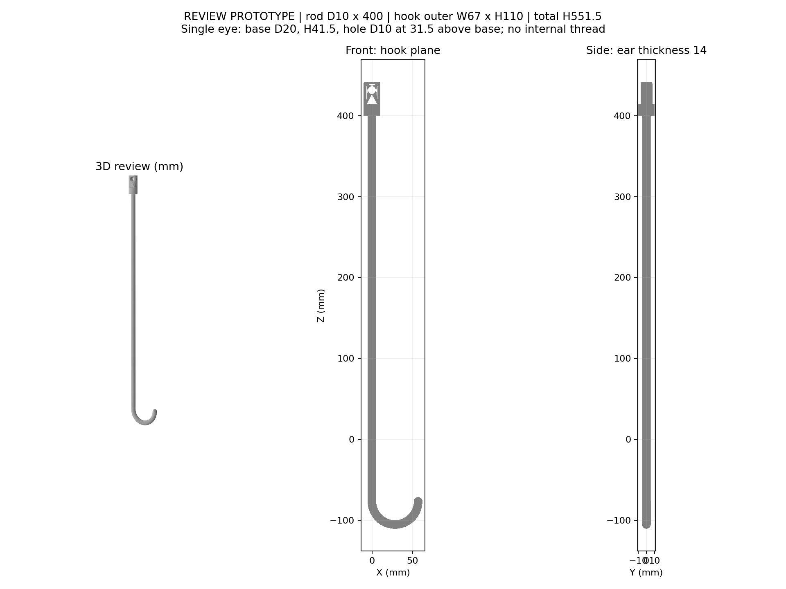
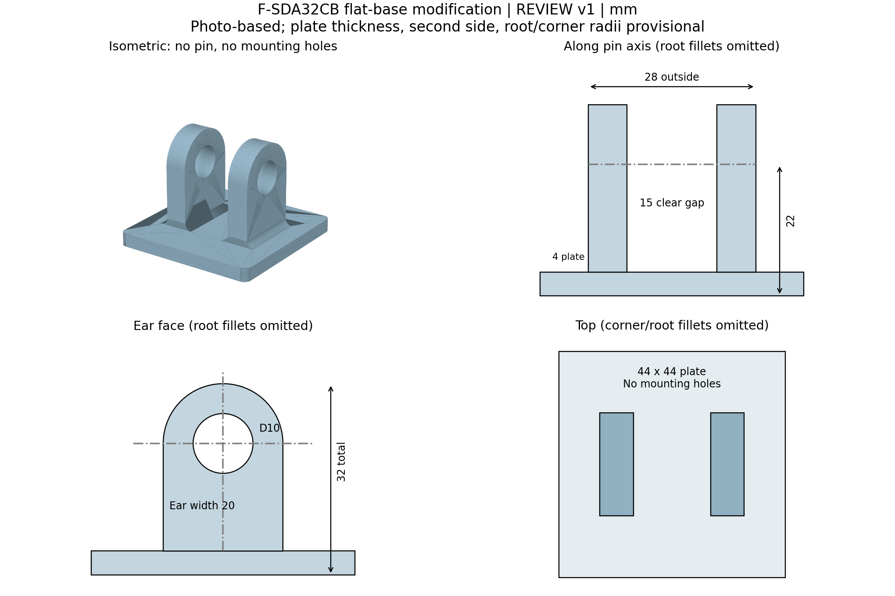
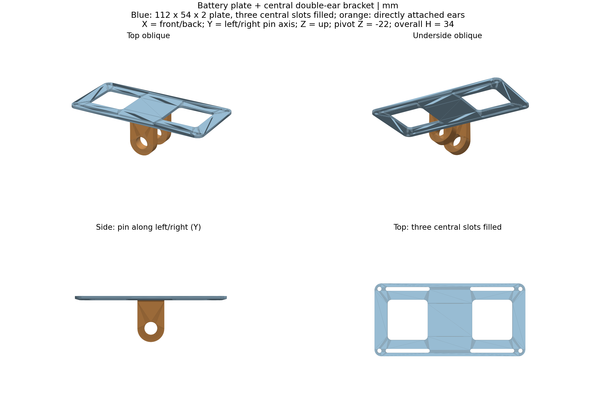

# 1-Dof hook-based UAV

## 钩杆设计核对版 v1

本版用于外形核对和接头试配，尚未验证实际承重能力。

- [下载全部设计文件 ZIP](designs/hook-v1/hook_files.zip)
- [外形预览](designs/hook-v1/preview.png)
- [PDF 核对图](designs/hook-v1/review_drawing.pdf)
- [STEP 模型](designs/hook-v1/hook_review.step)
- [整件打印 STL](designs/hook-v1/hook_review.stl)
- [接头试打印 STL](designs/hook-v1/connector_test.stl)
- [尺寸及设计假设](designs/hook-v1/说明.txt)
- [CadQuery 建模源码](designs/hook-v1/build.py)

点击文件后，使用 GitHub 文件页右上方的 **Download raw file** 下载按钮。也可在仓库首页点击 **Code → Download ZIP** 下载整个仓库。

单位为 mm。单耳接口参考用户提供的厂家图；直杆直径10、长度400；半圆钩外宽67、钩子区域高110；整件总高551.5。接头与杆一体成型，无M10×1.25内螺纹。顶端圆角、打印补偿及生产公差未最终确认。

建议先打印接头试配件，再确定材料、打印方向、打印设备尺寸及是否分段。PDF 为设计核对图，不是最终承重生产图。

## 32CB 双耳支架（平板底座）

去除底座十字凸起、安装孔和中间销轴。

- [全部文件 ZIP](designs/32cb-flat-v1/32cb_flat_files.zip)
- [尺寸说明](designs/32cb-flat-v1/README.md)
- [STEP](designs/32cb-flat-v1/32cb_flat.step) / [STL](designs/32cb-flat-v1/32cb_flat.stl)

图片未标明的底板厚度、另一边长度和圆角为暂定，详见尺寸说明。

## 电池底座与双耳支架一体件 v3（最新版，板厚2 mm）

电池板由1 mm向上加厚至2 mm，其余保持v2设计：中央三个细槽填实、无叠加加强底座、双耳直接连接底面。双耳、销孔、其他孔槽的位置和尺寸不变。

- [下载最新版全部文件](designs/battery-clevis-v3/battery_clevis_v3_files.zip)
- [尺寸与验证说明](designs/battery-clevis-v3/README.md)
- [STEP](designs/battery-clevis-v3/battery_with_clevis.step) / [STL](designs/battery-clevis-v3/battery_with_clevis.stl)

尚未完成承重验证。

历史版本：[v2：板厚1 mm](designs/battery-clevis-v2/README.md)；[v1：有4 mm加强板](designs/battery-clevis-v1/README.md)。
